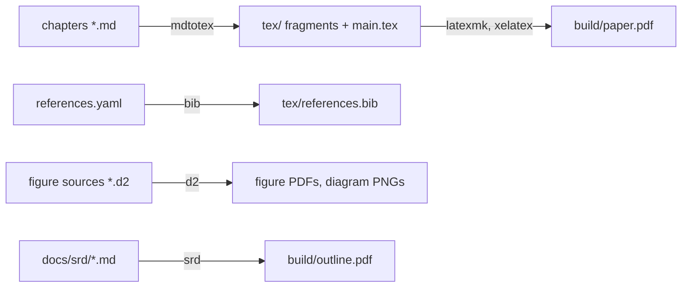

# paperkit

A Go library and a shared set of mage targets that build an academic paper from a directory of markdown chapters.

Papers rot when their build lives somewhere else: a manuscript copied between repositories stops compiling the day it loses the Makefile's parent directory. paperkit inverts that. A paper is one directory holding its chapters, its figures, its reference database, a `paper.yaml`, and a magefile of a few lines; the directory builds anywhere this module is fetchable, and every default resolves inside it. Markdown is the only source: the LaTeX under `tex/` is build output, regenerated on every build and removed by `clean`.



## What a paper directory contains

| Entry | Role |
|---|---|
| `paper.yaml` | build description: title page, chapter roster, class, preamble, output, and the optional settings below |
| `NN-slug.md` | chapters, `00-title-page.md` first; frontmatter carries title, author, abstract |
| `references.yaml` | the paper's own CSL-YAML corpus |
| `d2/` | figure sources, compiled to vector PDF beside each source |
| `docs/srd/` | section requirements documents, for papers drafted requirements-first, in the markdown form [srd/FORMAT.md](srd/FORMAT.md) defines |
| `tex/` | generated LaTeX: build output, not committed |
| `templates/` | the venue preamble and class files |
| `magefile.go` | imports the shared targets |

## The magefile

A paper imports its targets rather than writing them:

```go
//go:build mage

package main

import (
	//mage:import
	"github.com/petar-djukic/paperkit/papermage"
)

var Default = papermage.PDF
```

`papermage` provides `tex`, `figures`, `diagrams`, `bib`, `pdf`, `audit` and `clean`. Two more packages are imported only by the papers that use them: `papermage/outline` adds `outline`, and `papermage/wiki` adds `wiki`. Mage rejects a local target that shares an imported target's name, so a paper with checks of its own registers them with `papermage.BeforeAudit` from its magefile's `init`, and `audit` runs them first.

## Optional settings

| Key | Effect |
|---|---|
| `outline.format` | `tex`: a standalone IEEEtran outline compiled in `tex/`. `md`: a markdown chapter, `outline.md`, compiled as a one-chapter paper with the paper's own class. |
| `outline.class_options` | class options for an `md` outline, for a manuscript built in a referee layout |
| `diagrams` | directory that receives a PNG of every d2 source, for markdown pages that embed figures; `pdf` keeps it current |
| `wiki.template`, `wiki.sections` | an HTML template with one `{{NAME}}` per section, and the markdown file rendered into each; figures are inlined |
| `corpus` | the shared reference database this paper's `references.yaml` copies from; `audit` lists entries whose copy differs |

## Methodology

Conversion goes through the `mdtotex` package, a pure function from markdown bytes to LaTeX; the rest of paperkit owns everything around it. `GenerateTex` converts the roster, rejects cross-chapter label collisions before writing anything, and writes each fragment into `tex/`. `PDF` runs latexmk with xelatex and fails the build when the log reports a glyph no font provides, because latexmk exits zero on that and the character silently vanishes from print. `Audit` reports stale LaTeX, missing figures, and undefined citations from an actual compile.

`Audit` also compares each entry of the paper's `references.yaml` with the entry of the same id in the corpus, and reports the ones that differ without changing either. Either side may be the better record, since a paper's copy is often the one curated for print, so reconciling them is the author's decision.

The `bib` package converts the CSL-YAML corpus to BibTeX, normalizing date forms and organization authors that break `IEEEtran.bst`. The `srd` package reads a paper's section requirements documents and its VISION, in the markdown form [srd/FORMAT.md](srd/FORMAT.md) defines or in the YAML they were first written in, and renders them into an outline. `cmd/refs2bib` and `cmd/genoutline` run the same code by hand; `cmd/srd2md` converts a paper's YAML documents to markdown, proving each conversion before it writes.

## Use

```
go run github.com/magefile/mage pdf
```

from a paper directory whose `go.mod` requires this module. Requires d2, latexmk (TeX Live), and pandoc (for `bib` and `wiki`) on PATH.

## History

Extracted from [autogenic-systems](https://github.com/petar-djukic/autogenic-systems), where eight papers build with it; the commit history of the extraction is preserved. The pandoc conversion path this library once carried was removed before extraction. The converter, developed as the separate [md-to-tex](https://github.com/petar-djukic/md-to-tex) repository, was folded in as `mdtotex/` with its history (subtree merge at 2d29bf0); that repository is archived, and its HTTP service and requirement documents stay there.

## License

MIT. See [LICENSE](LICENSE).
